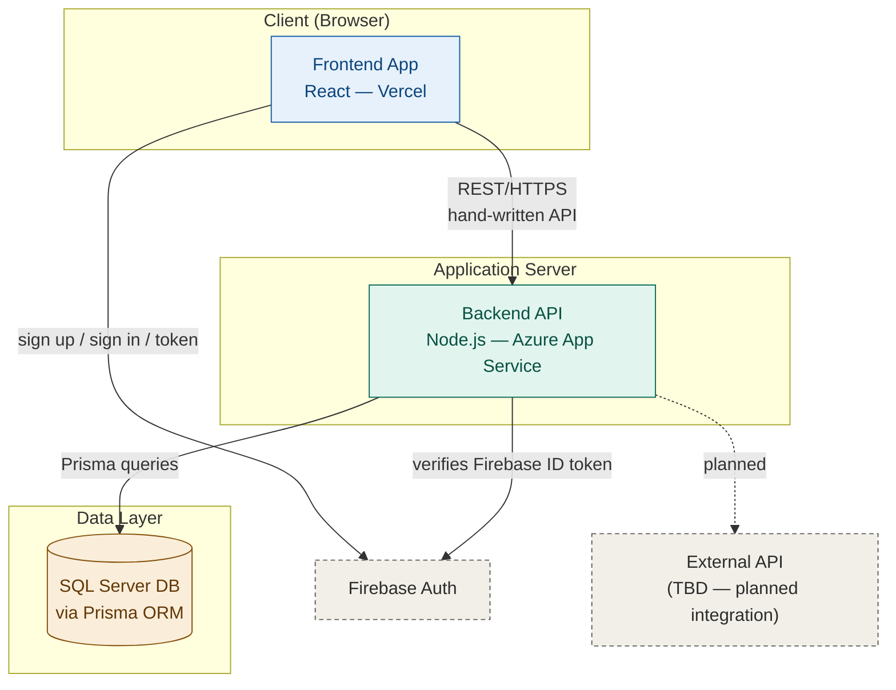
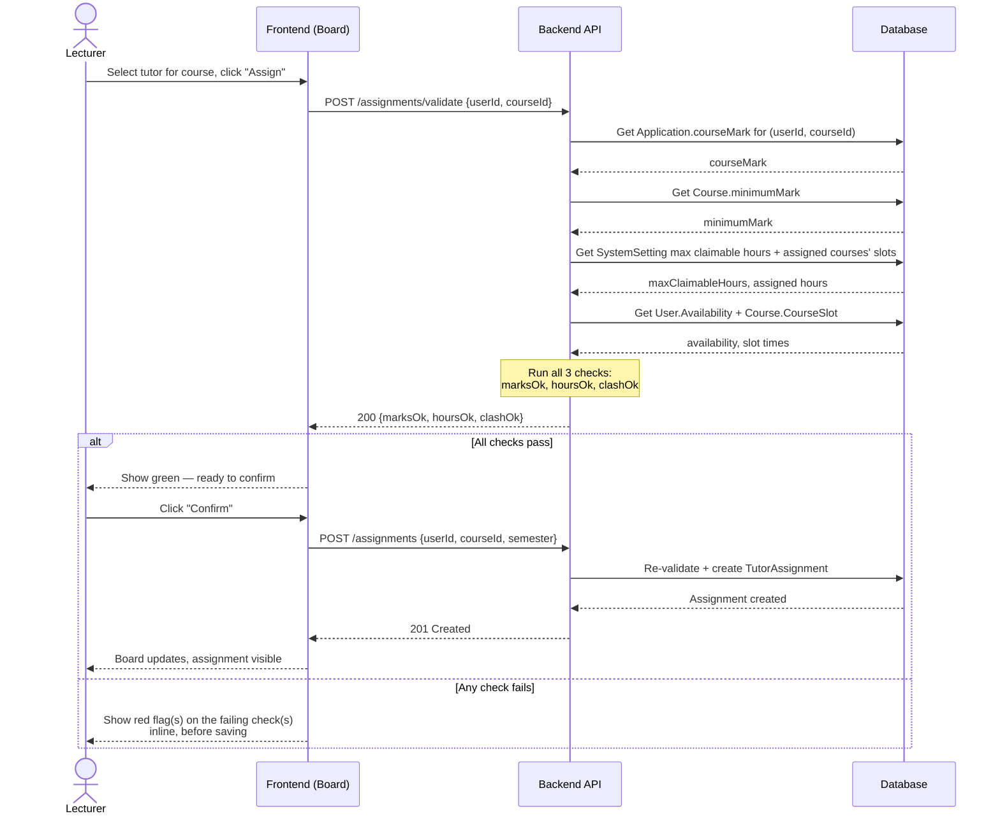

This page brings together the system design diagrams for the Tutor Management System: how the components fit together (component diagram), how the data is modelled (ER diagram), and how the core tutor-allocation flow works end to end (sequence diagram).

## Component Diagram

This diagram shows the high-level architecture of the Tutor Management System: how the frontend, backend, database, and third-party services connect.



### Notes

- **Non-monolithic split**: the frontend (React, deployed on Vercel) and backend (Node.js, deployed on Azure App Service) are separate deployable applications, communicating only over a hand-written REST API — satisfying the course's non-monolithic architecture requirement.
- **Auth**: Firebase Auth is used as an established authentication library, not a self-built system. The frontend handles sign-up/sign-in directly against Firebase; the backend verifies the resulting Firebase ID token on each request to identify the user and their role.
- **External API integration**: not yet decided at MS1 — the connection point is drawn here as planned/dashed to acknowledge the requirement exists, and will be filled in once the specific service is chosen (e.g. a timetable/calendar service).
- **Database**: SQL Server, accessed exclusively through Prisma ORM from the backend — the frontend never talks to the database directly.

## Data Model (ER Diagram)

This reflects the current `schema.prisma`. All user roles (student, tutor, lecturer, organiser, admin) live on `User.role` — there are no separate role tables. It covers the application/waitlist flow, course assignment, timesheets, and overflow work.

```mermaid
erDiagram
  USER ||--o{ APPLICATION : "submits"
  USER ||--o{ COURSE : "teaches"
  USER ||--o{ TUTOR_ASSIGNMENT : "tutors"
  USER ||--o{ AVAILABILITY : "sets"
  USER ||--o{ BUSY_BLOCK : "blocks"
  USER ||--o{ TIMESHEET : "submits"
  USER ||--o{ OVERFLOW_WORK : "claims"

  COURSE ||--o{ APPLICATION : "receives"
  COURSE ||--o{ TUTOR_ASSIGNMENT : "has"
  COURSE ||--o{ COURSE_SLOT : "scheduled at"
  COURSE ||--o{ OVERFLOW_WORK : "posts"
  COURSE ||--o{ TIMESHEET_ENTRY : "logged against"

  TUTOR_ASSIGNMENT ||--o{ SESSION : "generates"
  COURSE_SLOT ||--o{ SESSION : "schedules"
  TIMESHEET ||--o{ TIMESHEET_ENTRY : "contains"
  TIME_SLOT ||--o{ AVAILABILITY : "used by"
  TIME_SLOT ||--o{ COURSE_SLOT : "used by"

  USER ||--o{ SESSION_VOLUNTEER : "volunteers for"
  USER ||--o{ EVENT_REGISTER : "marked present on"
  USER ||--o{ SWAP_REQUEST : "trades events in"
  USER ||--o{ ROLE_APPLICATION : "applies for role"
  USER ||--o| TIMETABLE_PDF : "uploads"
  COURSE ||--o{ EVENT : "schedules"
  EVENT ||--o{ EVENT_REGISTER : "attendance list"
  EVENT ||--o{ TIMESHEET_ENTRY : "claimed as"
  SESSION ||--o| SESSION_VOLUNTEER : "has request"
  EVENT ||--o{ SWAP_REQUEST : "involves"

  USER {
    int id PK
    string firebaseUid UK
    string studentNumber
    string employeeNumber
    string firstName
    string lastName
    string email UK
    string role "STUDENT, TUTOR, LECTURER, ORGANISER, ADMIN"
    boolean isActive
  }
  APPLICATION {
    int id PK
    int userId FK
    int courseId FK
    float courseMark
    string status "PENDING, WAITLISTED, APPROVED, REJECTED"
    datetime appliedAt
    datetime reviewedAt
  }
  COURSE {
    int id PK
    string courseCode UK
    string courseName
    float minimumMark
    int tutorsRequired
    boolean acceptingApplications
    datetime createdAt
    int userId FK "owning lecturer or organiser"
  }
  TUTOR_ASSIGNMENT {
    int id PK
    int userId FK
    int courseId FK
    string semester
  }
  AVAILABILITY {
    int id PK
    int userId FK
    int dayOfWeek
    int timeSlotId FK
  }
  BUSY_BLOCK {
    int id PK
    int userId FK
    int dayOfWeek
    int startMinute
    int endMinute
  }
  COURSE_SLOT {
    int id PK
    int courseId FK
    int dayOfWeek
    int timeSlotId FK
    string venue
    string sessionType
  }
  SESSION {
    int id PK
    int assignmentId FK
    int courseSlotId FK
    datetime date
    string status
    string excuseReason
  }
  TIMESHEET {
    int id PK
    int userId FK
    string name
    string payrollNumber
    int totalHours
    string status "DRAFT, SUBMITTED, APPROVED, REJECTED"
    string rejectionReason
    datetime submittedAt
    datetime approvedAt
  }
  TIMESHEET_ENTRY {
    int id PK
    int timesheetId FK
    int courseId FK
    int supervisorId FK
    int eventId FK UK "set when auto-created from a claimed event"
    datetime workDate
    float duration
    string description "tutoring, marking, invigilation, admin"
    string status "PENDING, APPROVED, REJECTED"
  }
  OVERFLOW_WORK {
    int id PK
    int courseId FK
    string description
    int hours
    int postedBy
    int claimedBy FK
    string status
  }
  SYSTEM_SETTING {
    string key PK
    string value
    datetime updatedAt
  }
  EVENT {
    int id PK
    int courseId FK
    datetime date "UTC midnight; weekday drives timeslot lookup"
    string description "tutoring, marking, invigilation, admin"
    datetime createdAt
    datetime updatedAt
  }
  EVENT_REGISTER {
    int id PK
    int eventId FK
    int userId FK
    datetime markedAt
  }
  SWAP_REQUEST {
    int id PK
    int requesterId FK
    int recipientId FK
    int requesterEventId FK
    int recipientEventId FK "null = one-way handover"
    string status "PENDING, ACCEPTED, APPROVED, REJECTED, CANCELLED"
    string rejectionReason
    datetime reviewedAt
  }
  SESSION_VOLUNTEER {
    int id PK
    int sessionId FK UK
    int userId FK
    string status "PENDING, APPROVED, REJECTED"
    datetime createdAt
  }
  ROLE_APPLICATION {
    int id PK
    int userId FK
    string requestedRole "TUTOR or LECTURER"
    string status "PENDING, APPROVED, REJECTED"
    float hourlyRate "tutor applications"
    int maxHoursPerWeek "tutor applications"
    string department "lecturer applications"
    string rejectionReason
    datetime submittedAt
    datetime reviewedAt
  }
  TIMETABLE_PDF {
    int id PK
    int userId FK UK
    string filename
    string extractedSlots "JSON"
    datetime uploadedAt
  }
  EMAIL_LOG {
    int id PK
    string eventType
    string entityType
    int entityId
    string dedupeKey
    string recipientEmail
    string status "PENDING, SENT, FAILED"
    datetime sentAt
    string errorMessage
  }
```

### Notes on modeling decisions

- **One `User` table, roles as a string**: `User.role` distinguishes student / tutor / lecturer / organiser / admin. There are no separate role tables — every tutor-role construct (availability, busy blocks, assignments, timesheets, overflow claims) references `User` directly, so a user's data survives role changes.
- **Waitlist is a status, not a new entity**: `Application.status` moves through `PENDING → WAITLISTED / APPROVED / REJECTED`. When an approved applicant declines or a `TutorAssignment` frees up, the next-ranked `WAITLISTED` application (ordered by `courseMark`) can be promoted to `APPROVED` without any schema change.
- **`TutorAssignment` is the join entity** between `User` (tutor role) and `Course`, carrying only the `semester` — the many-to-many relationship of which users tutor which courses. Hours are not stored: they are derived from the course's slots (each slot rounds up to at least one whole hour), and the overall cap lives in `SystemSetting` (`TUTOR_MONTHLY_CLAIMABLE_HOURS`, set by an organiser).
- **Availability vs `CourseSlot`**: a tutor's own weekly availability (`Availability`) is checked against each course's fixed teaching times (`CourseSlot`) to detect scheduling clashes — these are separate tables because tutors set availability once per term, while course slots are fixed by the timetable. Both reference the shared `TimeSlot` catalogue.

:::note

The ER diagram above mirrors the current `schema.prisma`, including the event attendance register (`EventRegister`) added with the events register feature: one row per tutor the owning lecturer marked present on an event, which timesheet approval checks before an event entry can be approved.

:::

## Sequence Diagram: Assigning a Tutor to a Course

This shows the core Basic-tier flow: a lecturer assigns a tutor to a course from the allocation board, with all three validation checks (marks, timetable clash, remaining hours) run server-side through **one combined validation endpoint**.



### Notes

- **One combined endpoint** (`POST /assignments/validate`) runs all three checks server-side in a single request/response cycle, rather than three separate calls or purely client-side checks. This keeps the validation logic centralized and easy to test (directly satisfies the automated API testing rubric line).
- **Live feedback**: the check runs as soon as the lecturer selects a tutor and clicks "Assign" — before anything is saved — satisfying the brief's requirement that a broken choice be "visible as it is made, not after it is saved."
- **Two-step confirm**: a final `POST /assignments` re-validates server-side at the moment of actual commit, guarding against race conditions (e.g. two lecturers assigning the same tutor to different courses at the same time, both passing the initial check).
