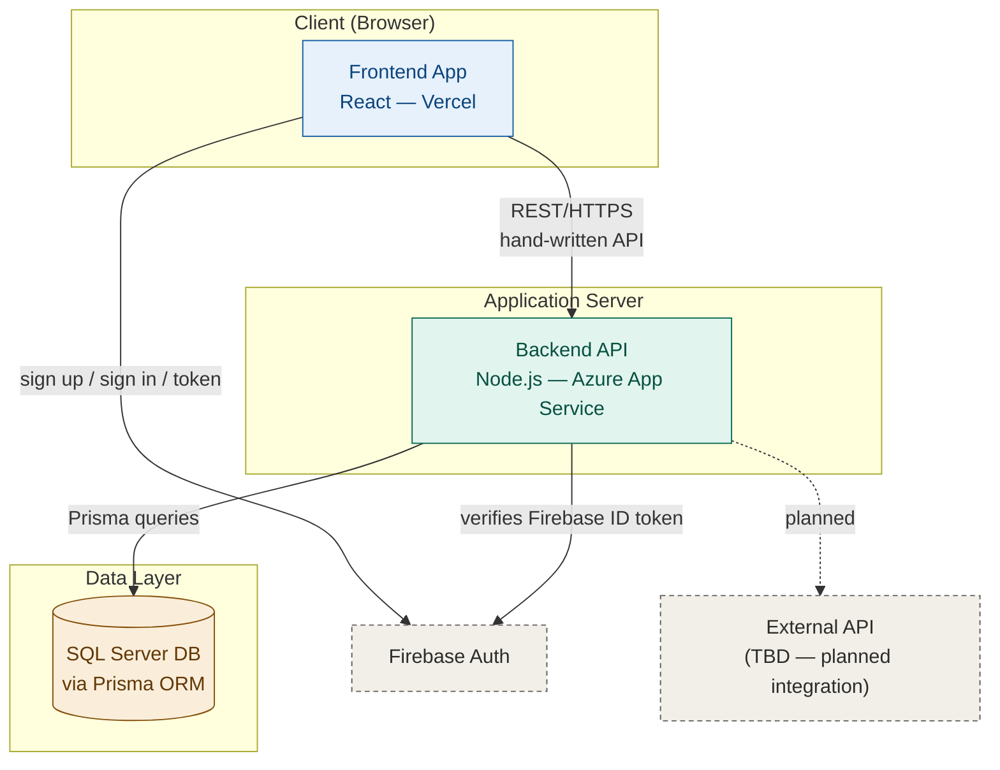

# System Design — Component Diagram

This diagram shows the high-level architecture of the Tutor Management System: how the frontend, backend, database, and third-party services connect.

## Notes

- **Non-monolithic split**: the frontend (React, deployed on Vercel) and backend (Node.js, deployed on Azure App Service) are separate deployable applications, communicating only over a hand-written REST API — satisfying the course's non-monolithic architecture requirement.
- **Auth**: Firebase Auth is used as an established authentication library, not a self-built system. The frontend handles sign-up/sign-in directly against Firebase; the backend verifies the resulting Firebase ID token on each request to identify the user and their role.
- **External API integration**: not yet decided at MS1 — the connection point is drawn here as planned/dashed to acknowledge the requirement exists, and will be filled in once the specific service is chosen (e.g. a timetable/calendar service).
- **Database**: SQL Server, accessed exclusively through Prisma ORM from the backend — the frontend never talks to the database directly.
