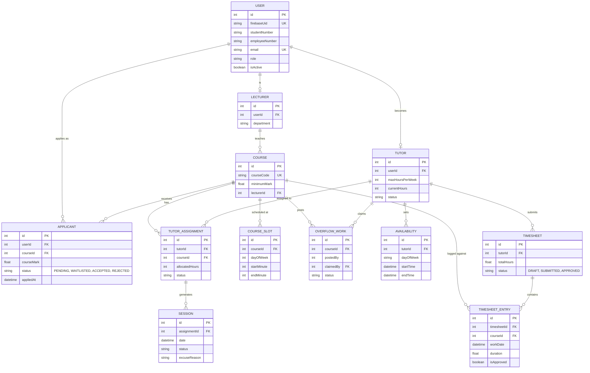

# System Design — Data Model (ER Diagram)

This reflects the current `schema.prisma`. It covers three user roles (student, tutor, lecturer via `User.role`), the application/waitlist flow, course assignment, timesheets, and overflow work.

## Notes on modeling decisions

- **Three roles, one `User` table**: `User.role` distinguishes student / tutor / lecturer, with `Tutor` and `Lecturer` as optional 1-to-1 extension tables holding role-specific fields (hours, department). A student who hasn't applied yet has neither.
- **Waitlist is a status, not a new entity**: `Applicant.status` moves through `PENDING → WAITLISTED / ACCEPTED / REJECTED`. When an accepted applicant declines or a `TutorAssignment` frees up, the next-ranked `WAITLISTED` applicant (ordered by `courseMark`) can be promoted to `ACCEPTED` without any schema change.
- **`TutorAssignment` is the join entity** between `Tutor` and `Course`, carrying `allocatedHours` and `status` — this is where the three live-validation checks (marks, clash, hours) get enforced before a row is created.
- **Availability vs `CourseSlot`**: a tutor's own weekly availability (`Availability`) is checked against each course's fixed teaching times (`CourseSlot`) to detect scheduling clashes — these are separate tables because tutors set availability once per term, while course slots are fixed by the timetable.
