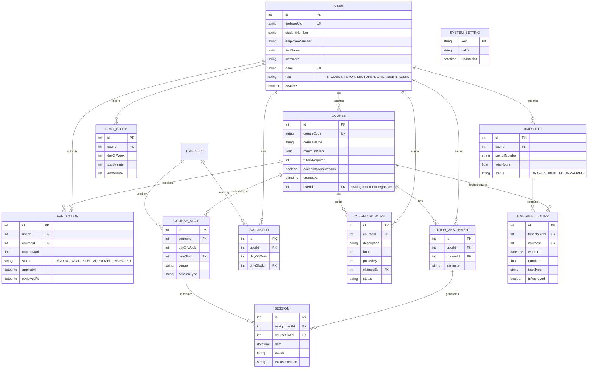

# System Design — Data Model (ER Diagram)

This reflects the current `schema.prisma`. All user roles (student, tutor, lecturer, organiser, admin) live on `User.role` — there are no separate role tables. It covers the application/waitlist flow, course assignment, timesheets, and overflow work.

## Notes on modeling decisions

- **One `User` table, roles as a string**: `User.role` distinguishes student / tutor / lecturer / organiser / admin. There are no separate role tables — every tutor-role construct (availability, busy blocks, assignments, timesheets, overflow claims) references `User` directly, so a user's data survives role changes.
- **Waitlist is a status, not a new entity**: `Application.status` moves through `PENDING → WAITLISTED / APPROVED / REJECTED`. When an approved applicant declines or a `TutorAssignment` frees up, the next-ranked `WAITLISTED` application (ordered by `courseMark`) can be promoted to `APPROVED` without any schema change.
- **`TutorAssignment` is the join entity** between `User` (tutor role) and `Course`, carrying only the `semester` — the many-to-many relationship of which users tutor which courses. Hours are not stored: they are derived from the course's slots (each slot rounds up to at least one whole hour), and the overall cap lives in `SystemSetting` (`TUTOR_MONTHLY_CLAIMABLE_HOURS`, set by an organiser).
- **Availability vs `CourseSlot`**: a tutor's own weekly availability (`Availability`) is checked against each course's fixed teaching times (`CourseSlot`) to detect scheduling clashes — these are separate tables because tutors set availability once per term, while course slots are fixed by the timetable. Both reference the shared `TimeSlot` catalogue.
