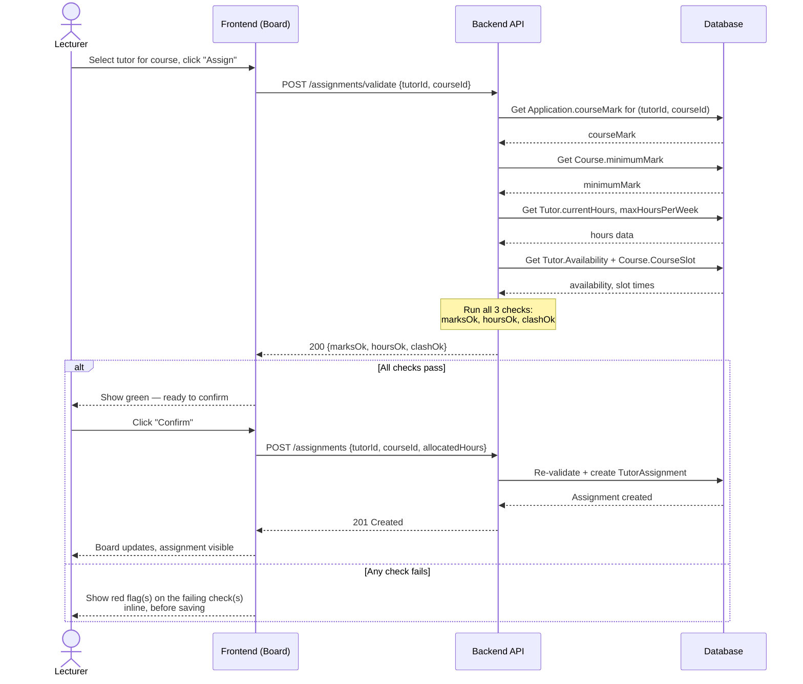

# System Design — Sequence Diagram: Assigning a Tutor to a Course

This shows the core Basic-tier flow: a lecturer assigns a tutor to a course from the allocation board, with all three validation checks (marks, timetable clash, remaining hours) run server-side through **one combined validation endpoint**.

## Notes

- **One combined endpoint** (`POST /assignments/validate`) runs all three checks server-side in a single request/response cycle, rather than three separate calls or purely client-side checks. This keeps the validation logic centralized and easy to test (directly satisfies the automated API testing rubric line).
- **Live feedback**: the check runs as soon as the lecturer selects a tutor and clicks "Assign" — before anything is saved — satisfying the brief's requirement that a broken choice be "visible as it is made, not after it is saved."
- **Two-step confirm**: a final `POST /assignments` re-validates server-side at the moment of actual commit, guarding against race conditions (e.g. two lecturers assigning the same tutor to different courses at the same time, both passing the initial check).
