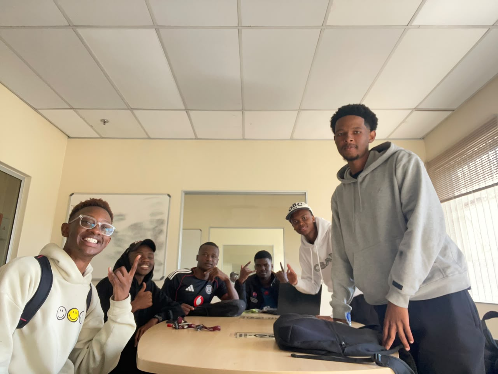
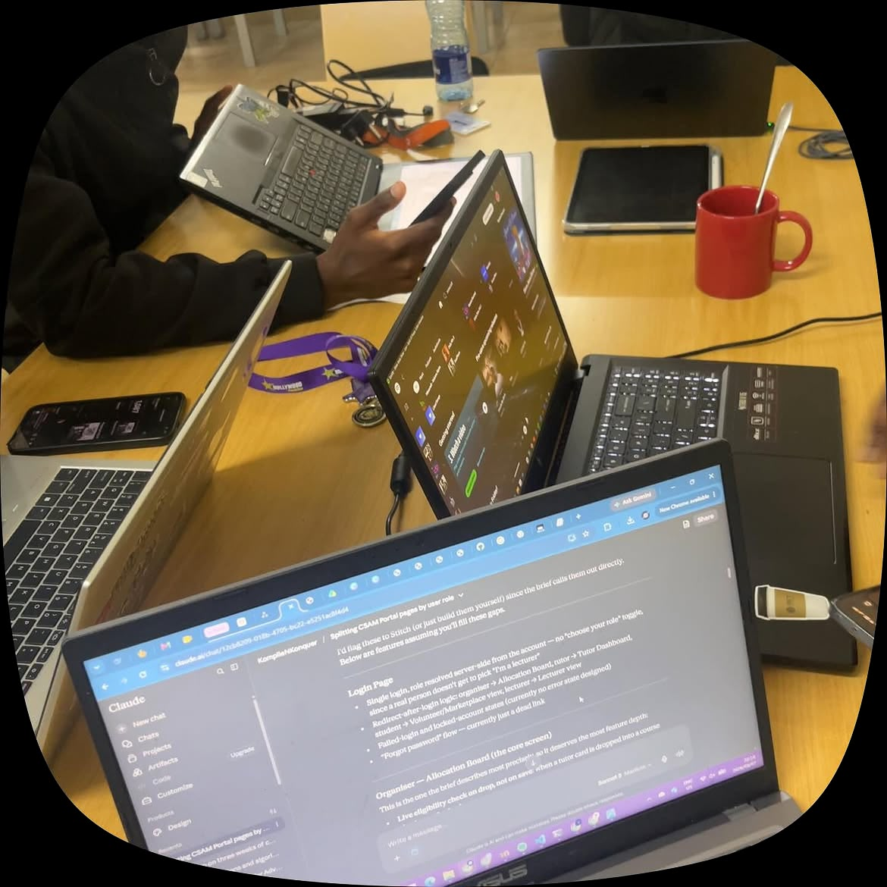
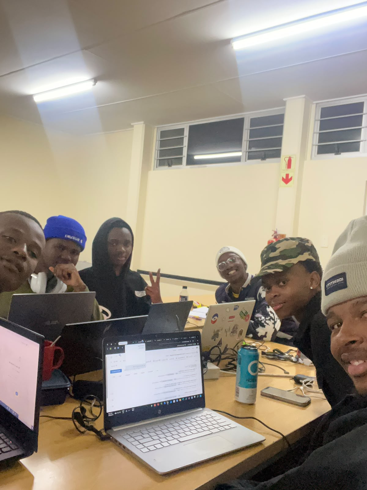

# Sprint 1
## Meeting 1

**Date: July 28**
**Time: 1pm - 2pm**
**Location: Commerce Library**
**Attendees: Tlhalefo, Nduvho, Kgaogelo, Nhlamulo, Mogomotsi, Ndumiso**

**Agenda**
* Discussion of which topic we are going to choose to work on and why.

**Decisions**
* Tutor Management System will be our first option, followed by others that we liked.

**Action Items**
* Ndumiso should submit our ranking of which topics we want to work on the Google Form.

**Next Meeting: 05 August**

---

## Meeting 2

**Date: Wednesday, 05 August**
**Time: 2pm - 4pm**
**Location: Commerce Library**
**Attendees: Tlhalefo, Ndumiso, Nhlamulo, Mogomotsi, Kgaogelo**

**Agenda**
* Discussion regarding how we are going to work on the app; figuring out semantics and roughly assigning roles.

**Decisions**
* We decided that there will be 3 roles/3 different users on our website: a student, a tutor and a lecturer.

**Action Items**
* Nhlamulo should let Brendan know that we do not have a client anymore and find out about a new one.

**Next Meeting: 07 August 2026**

---

## Meeting 3

**Date: Friday, 07 August**
**Time: 19:30 to 00:30**
**Location: Knockando H-Block TV Room**
**Attendees: Ndumiso, Nhlamulo, Nduvho, Kgaogelo, Mogomotsi**

**Agenda**
* Getting started with the project.

**Decisions**
* We will have to decide on a name for our group project: Tutor Flow/Tutor Schedule seeming more likely.
* A database schema will have to be set up.
* We need to get started on our frontend.

**Action Items**
* Nhlamulo will work on frontend.
* Tlhalefo will work on authentication.
* Ndumiso and Mogomotsi will be our testers, as well as Mogomotsi helping with setting up our repo.
* Nduvho will check out deployment of the web app.
* Kgaogelo will work on the backend and database side of the app with Mogomotsi.

**Next Meeting: 14 August**

---

## Meeting 4

**Date: Friday, 14 August**
**Time: 19:00 - 03:00**
**Location: Knockando Hall of Residence, Graham's Study Room**
**Attendees: Ndumiso, Nduvho, Nhlamulo, Mogomotsi, Tlhalefo, Kgaogelo**

**Agenda**
* Working meeting; everyone should work together on what they were assigned to do.

**Decisions**
* Everyone should make more effort to check out each other's pull requests.

**Action Items**
* Everyone should get their assigned tasks done ASAP.

**Next Meeting: undecided**

---

## Meeting 5

**Date: Friday, 21 August**
**Time: 19:00 to 00:20am**
**Location: Knockando Halls of Residence, H-Block TV Room**
**Attendees: Tlhalefo, Nhlamulo, Mogomotsi, Nduvho, Ndumiso, Kgaogelo**

**Agenda**
* Working meeting, everyone should conclude their assigned tasks for this sprint and make sure that all components of the web app work well together.

**Decisions**
* Have a final meeting with our client to make sure that we are on track with what he requires from us.

**Action Items**
* Prepare for our sprint marking.

**Next Meeting: undecided**

---

# Sprint 2

## Meeting 1

**Date: Monday, 14 September (going into Tuesday, 15 September)**
**Time: 18:00 to 06:00**
**Location: Knockando Halls of Residence, H-Block TV Room**
**Attendees: Tlhalefo, Nhlamulo, Mogomotsi, Nduvho, Ndumiso, Kgaogelo**

**Agenda**
* Working meeting — everyone to work through the night on their assigned Sprint 2 tasks and make sure all components of the web app work well together.

**Decisions**
* Keep clearing the open pull requests and merge conflicts until all Sprint 2 work is merged and working together on `main`.

**Action Items**
* Everyone to finish their assigned Sprint 2 tasks ahead of sprint marking.

**Next Meeting: undecided**

---

# Sprint 3

## Meeting 1

**Date: Friday, 25 September**
**Time: [time — fill in]**
**Location: [location — fill in]**
**Attendees: Mogomotsi, Ndumiso, Nhlamulo**

**Agenda**
* Discuss and work on the things we want to implement for Sprint 3.

**Decisions**
* Confirmed the Sprint 3 work items: the MS3 testing milestone, the landing page redesign, and the excuse/volunteer tutor workflow.

**Action Items**
* Attendees to start on their assigned Sprint 3 tasks and report back at the next meeting.

**Next Meeting: 26 September**

---

## Meeting 2

**Date: Saturday, 26 September**
**Time: [time — fill in]**
**Location: [location — fill in]**
**Attendees: Tlhalefo, Nhlamulo, Mogomotsi, Nduvho, Ndumiso, Kgaogelo**

**Agenda**
* Full-team session to discuss and work on the things we want to implement for Sprint 3.

**Decisions**
* Work divided among all six members against the Sprint 3 goal and scope.

**Action Items**
* Everyone to work on their assigned Sprint 3 tasks ahead of milestone marking.

**Next Meeting: undecided**